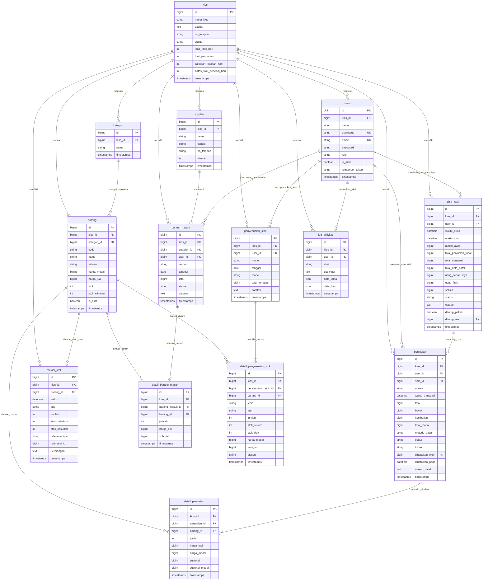

# 03. Entity Relationship Diagram (ERD) dan Kamus Data

Dokumen ini mendokumentasikan skema basis data relasional **Stokify** (MySQL InnoDB) yang mencakup 14 tabel, relasi antar-entitas, kunci asing (*foreign keys*), indeks performa, serta kamus data lengkap.

---

## 1. Diagram Relasi Entitas (Mermaid ERD)

---

## 2. Kamus Data Rinci (Data Dictionary)

### 1. Tabel `kios`
Menyimpan profil entitas usaha kios yang mendaftar pada sistem.
- `id` (BIGINT UNSIGNED, PK, Auto Increment)
- `nama_kios` (VARCHAR 100, NOT NULL)
- `alamat` (TEXT, NULLABLE)
- `no_telepon` (VARCHAR 20, NULLABLE)
- `status` (VARCHAR 20, DEFAULT 'aktif')
- `lead_time_hari` (INT, DEFAULT 2): Parameter perkiraan waktu tunggu kirim pasokan.
- `hari_pengaman` (INT, DEFAULT 3): Parameter hari persediaan pengaman (*safety stock*).
- `cakupan_kulakan_hari` (INT, DEFAULT 7): Parameter target hari penjualan per belanja stok.
- `batas_stok_berlebih_hari` (INT, DEFAULT 30): Parameter ambang batas stok berlebih (*overstock*).
- `created_at`, `updated_at` (TIMESTAMP)

### 2. Tabel `users`
Akun login pemilik (admin) dan petugas kasir.
- `id` (BIGINT UNSIGNED, PK, Auto Increment)
- `kios_id` (BIGINT UNSIGNED, FK -> kios.id ON DELETE CASCADE)
- `name` (VARCHAR 100, NOT NULL)
- `username` (VARCHAR 50, UNIQUE, NOT NULL)
- `email` (VARCHAR 100, UNIQUE, NULLABLE)
- `password` (VARCHAR 255, NOT NULL)
- `role` (ENUM: 'admin', 'kasir', NOT NULL)
- `is_aktif` (BOOLEAN, DEFAULT true)
- `remember_token` (VARCHAR 100, NULLABLE)
- `created_at`, `updated_at` (TIMESTAMP)

### 3. Tabel `kategori`
Pengelompokan barang dagangan per kios.
- `id` (BIGINT UNSIGNED, PK, Auto Increment)
- `kios_id` (BIGINT UNSIGNED, FK -> kios.id ON DELETE CASCADE)
- `nama` (VARCHAR 100, NOT NULL)
- Indeks: `UNIQUE(kios_id, nama)`

### 4. Tabel `barang`
Master data produk dan persediaan per kios.
- `id` (BIGINT UNSIGNED, PK, Auto Increment)
- `kios_id` (BIGINT UNSIGNED, FK -> kios.id ON DELETE CASCADE)
- `kategori_id` (BIGINT UNSIGNED, NULLABLE, FK -> kategori.id ON DELETE SET NULL)
- `kode` (VARCHAR 50, NOT NULL): Barcode atau kode internal barang.
- `nama` (VARCHAR 150, NOT NULL)
- `satuan` (VARCHAR 20, NOT NULL)
- `harga_modal` (BIGINT UNSIGNED, NOT NULL): HPP berjalan (metode Moving Average).
- `harga_jual` (BIGINT UNSIGNED, NOT NULL): Harga jual ritel saat ini.
- `stok` (INT, NOT NULL, DEFAULT 0): Saldo persediaan fisik di rak/toko.
- `stok_minimum` (INT, NOT NULL, DEFAULT 5): Ambang batas peringatan stok menipis.
- `is_aktif` (BOOLEAN, DEFAULT true)
- Indeks: `UNIQUE(kios_id, kode)`, `INDEX(kios_id, nama)`

### 5. Tabel `supplier`
Data mitra distributor pasokan barang.
- `id` (BIGINT UNSIGNED, PK, Auto Increment)
- `kios_id` (BIGINT UNSIGNED, FK -> kios.id ON DELETE CASCADE)
- `nama` (VARCHAR 100, NOT NULL)
- `kontak` (VARCHAR 100, NULLABLE)
- `no_telepon` (VARCHAR 20, NULLABLE)
- `alamat` (TEXT, NULLABLE)

### 6. Tabel `barang_masuk`
Header transaksi pengadaan pasokan dari supplier.
- `id` (BIGINT UNSIGNED, PK, Auto Increment)
- `kios_id` (BIGINT UNSIGNED, FK -> kios.id)
- `supplier_id` (BIGINT UNSIGNED, NULLABLE, FK -> supplier.id ON DELETE SET NULL)
- `user_id` (BIGINT UNSIGNED, FK -> users.id)
- `nomor` (VARCHAR 50, NOT NULL): Format `BM-YYYYMMDD-XXXX`.
- `tanggal` (DATE, NOT NULL)
- `total` (BIGINT UNSIGNED, NOT NULL): Jumlah total nilai faktur belanja.
- `status` (ENUM: 'draft', 'selesai', 'dibatalkan', DEFAULT 'selesai')
- `catatan` (TEXT, NULLABLE)
- Indeks: `UNIQUE(kios_id, nomor)`, `INDEX(kios_id, tanggal)`

### 7. Tabel `detail_barang_masuk`
Baris rincian item barang masuk.
- `id` (BIGINT UNSIGNED, PK, Auto Increment)
- `kios_id` (BIGINT UNSIGNED, FK -> kios.id)
- `barang_masuk_id` (BIGINT UNSIGNED, FK -> barang_masuk.id ON DELETE CASCADE)
- `barang_id` (BIGINT UNSIGNED, FK -> barang.id)
- `jumlah` (INT UNSIGNED, NOT NULL)
- `harga_beli` (BIGINT UNSIGNED, NOT NULL)
- `subtotal` (BIGINT UNSIGNED, NOT NULL)

### 8. Tabel `penyesuaian_stok`
Header transaksi penyesuaian selisih stok manual atau stok opname.
- `id` (BIGINT UNSIGNED, PK, Auto Increment)
- `kios_id` (BIGINT UNSIGNED, FK -> kios.id)
- `user_id` (BIGINT UNSIGNED, FK -> users.id)
- `nomor` (VARCHAR 50, NOT NULL): Format `ADJ-YYYYMMDD-XXXX`.
- `tanggal` (DATE, NOT NULL)
- `mode` (ENUM: 'manual', 'opname', NOT NULL)
- `total_kerugian` (BIGINT UNSIGNED, DEFAULT 0)
- `catatan` (TEXT, NULLABLE)
- Indeks: `UNIQUE(kios_id, nomor)`, `INDEX(kios_id, tanggal)`

### 9. Tabel `detail_penyesuaian_stok`
Rincian item barang yang disesuaikan stoknya.
- `id` (BIGINT UNSIGNED, PK, Auto Increment)
- `kios_id` (BIGINT UNSIGNED, FK -> kios.id)
- `penyesuaian_stok_id` (BIGINT UNSIGNED, FK -> penyesuaian_stok.id ON DELETE CASCADE)
- `barang_id` (BIGINT UNSIGNED, FK -> barang.id)
- `jenis` (ENUM: 'rusak', 'hilang', 'kadaluarsa', 'koreksi_sistem', 'opname')
- `arah` (ENUM: 'tambah', 'kurang')
- `jumlah` (INT UNSIGNED, NOT NULL)
- `stok_sistem` (INT, NULLABLE)
- `stok_fisik` (INT, NULLABLE)
- `harga_modal` (BIGINT UNSIGNED, NOT NULL): Snapshot HPP saat penyesuaian dicatat.
- `kerugian` (BIGINT UNSIGNED, DEFAULT 0): Nilai kerugian finansial.
- `alasan` (VARCHAR 255, NOT NULL)

### 10. Tabel `shift_kasir`
Rekap sesi kerja dan rekonsiliasi kas kasir per individu.
- `id` (BIGINT UNSIGNED, PK, Auto Increment)
- `kios_id` (BIGINT UNSIGNED, FK -> kios.id)
- `user_id` (BIGINT UNSIGNED, FK -> users.id)
- `waktu_buka` (DATETIME, NOT NULL)
- `waktu_tutup` (DATETIME, NULLABLE)
- `modal_awal` (BIGINT UNSIGNED, NOT NULL): Kas kecil pembukaan laci.
- `total_penjualan_tunai` (BIGINT UNSIGNED, DEFAULT 0): Snapshot total omzet nota selesai.
- `total_transaksi` (INT UNSIGNED, DEFAULT 0): Jumlah nota berstatus selesai.
- `total_nota_batal` (INT UNSIGNED, DEFAULT 0): Jumlah nota yang dibatalkan.
- `uang_seharusnya` (BIGINT UNSIGNED, DEFAULT 0): Modal awal + Total penjualan tunai selesai.
- `uang_fisik` (BIGINT UNSIGNED, NULLABLE): Input hitung buta uang laci kasir saat tutup.
- `selisih` (BIGINT, DEFAULT 0): Uang fisik - Uang seharusnya.
- `status` (ENUM: 'berjalan', 'ditutup', DEFAULT 'berjalan')
- `catatan` (TEXT, NULLABLE): Wajib diisi jika ada selisih uang.
- `ditutup_paksa` (BOOLEAN, DEFAULT false)
- `ditutup_oleh` (BIGINT UNSIGNED, NULLABLE, FK -> users.id)
- Indeks: `INDEX(kios_id, user_id, status)`, `INDEX(kios_id, waktu_buka)`

### 11. Tabel `penjualan`
Header transaksi penjualan kasir (POS).
- `id` (BIGINT UNSIGNED, PK, Auto Increment)
- `kios_id` (BIGINT UNSIGNED, FK -> kios.id)
- `user_id` (BIGINT UNSIGNED, FK -> users.id)
- `shift_id` (BIGINT UNSIGNED, FK -> shift_kasir.id)
- `nomor` (VARCHAR 50, NOT NULL): Format `TRX-YYYYMMDD-XXXX`.
- `waktu_transaksi` (DATETIME, NOT NULL)
- `total` (BIGINT UNSIGNED, NOT NULL): Total harga belanja pembeli.
- `bayar` (BIGINT UNSIGNED, NOT NULL): Nominal uang tunai diserahkan pembeli.
- `kembalian` (BIGINT UNSIGNED, NOT NULL): Uang kembalian yang diberikan.
- `total_modal` (BIGINT UNSIGNED, NOT NULL): Snapshot total HPP barang yang terjual.
- `metode_bayar` (VARCHAR 20, DEFAULT 'tunai')
- `status` (ENUM: 'selesai', 'dibatalkan', DEFAULT 'selesai')
- `token` (VARCHAR 64, NOT NULL): Token idempotency mencegah submit ganda.
- `dibatalkan_oleh` (BIGINT UNSIGNED, NULLABLE, FK -> users.id)
- `dibatalkan_pada` (DATETIME, NULLABLE)
- `alasan_batal` (TEXT, NULLABLE)
- Indeks: `UNIQUE(kios_id, nomor)`, `UNIQUE(kios_id, token)`, `INDEX(kios_id, waktu_transaksi, status)`

### 12. Tabel `detail_penjualan`
Item rincian nota belanja kasir.
- `id` (BIGINT UNSIGNED, PK, Auto Increment)
- `kios_id` (BIGINT UNSIGNED, FK -> kios.id)
- `penjualan_id` (BIGINT UNSIGNED, FK -> penjualan.id ON DELETE CASCADE)
- `barang_id` (BIGINT UNSIGNED, FK -> barang.id)
- `jumlah` (INT UNSIGNED, NOT NULL)
- `harga_jual` (BIGINT UNSIGNED, NOT NULL): Snapshot harga jual per unit saat transaksi.
- `harga_modal` (BIGINT UNSIGNED, NOT NULL): Snapshot harga modal per unit saat transaksi.
- `subtotal` (BIGINT UNSIGNED, NOT NULL): `jumlah * harga_jual`
- `subtotal_modal` (BIGINT UNSIGNED, NOT NULL): `jumlah * harga_modal`

### 13. Tabel `mutasi_stok`
Buku besar (*ledger*) pergerakan keluar-masuk setiap unit barang.
- `id` (BIGINT UNSIGNED, PK, Auto Increment)
- `kios_id` (BIGINT UNSIGNED, FK -> kios.id)
- `barang_id` (BIGINT UNSIGNED, FK -> barang.id)
- `waktu` (DATETIME, NOT NULL)
- `tipe` (ENUM: 'stok_awal', 'barang_masuk', 'penjualan', 'penyesuaian', 'void_penjualan')
- `jumlah` (INT NOT NULL): Positif jika menambah persediaan, negatif jika mengurangi.
- `stok_sebelum` (INT NOT NULL)
- `stok_sesudah` (INT NOT NULL)
- `referensi_tipe` (VARCHAR 50, NULLABLE): Model asal transaksi.
- `referensi_id` (BIGINT UNSIGNED, NULLABLE): ID nota terkait.
- `keterangan` (TEXT, NULLABLE)
- Indeks: `INDEX(kios_id, barang_id, waktu)`

### 14. Tabel `log_aktivitas`
Jejak audit keamanan (*audit trail*) atas seluruh operasi krusial.
- `id` (BIGINT UNSIGNED, PK, Auto Increment)
- `kios_id` (BIGINT UNSIGNED, FK -> kios.id)
- `user_id` (BIGINT UNSIGNED, NULLABLE, FK -> users.id)
- `aksi` (VARCHAR 50, NOT NULL): Kode aksi (misal: `barang.tambah`, `penjualan.buat`, `shift.tutup`).
- `deskripsi` (TEXT, NOT NULL): Narasi aktivitas yang dapat dibaca manusia.
- `data_lama` (JSON, NULLABLE): Snapshot nilai sebelum diubah.
- `data_baru` (JSON, NULLABLE): Snapshot nilai setelah diubah (otomatis tersensor untuk field sensitif).
- Indeks: `INDEX(kios_id, aksi, created_at)`
