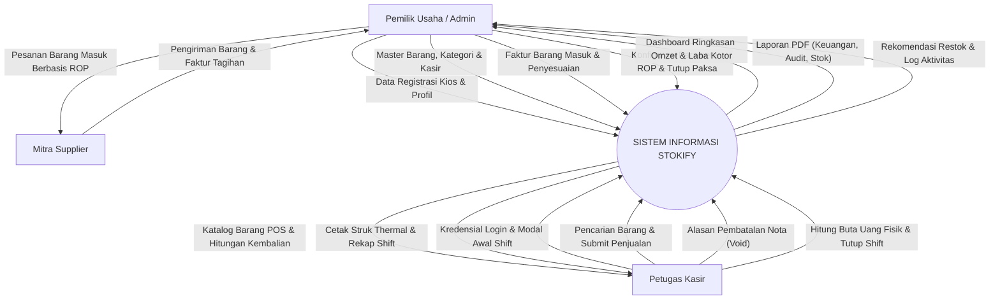

# 04. Data Flow Diagram (DFD)

Dokumen ini memetakan aliran data pada sistem informasi **Stokify** melalui Diagram Alir Data (*Data Flow Diagram* / DFD), dimulai dari DFD Level 0 (Diagram Konteks) hingga DFD Level 1 yang merinci 9 proses bisnis inti beserta 14 penyimpan data (*data stores*).

---

## 1. DFD Level 0: Diagram Konteks (Context Diagram)

Diagram konteks menggambarkan batasan sistem Stokify dan interaksinya dengan 3 entitas eksternal: **Pemilik Usaha (Admin)**, **Petugas Kasir**, dan **Supplier (Pemasok)**.

---

## 2. Pemetaan Data Store (D1 s/d D14)

Penyimpan data (*data stores*) pada DFD Level 1 dipetakan langsung ke 14 tabel database relasional:

- **D1**: `kios` (Data Profil Kios & Parameter ROP)
- **D2**: `users` (Akun Pengguna Admin & Kasir)
- **D3**: `kategori` (Klasifikasi Kategori Produk)
- **D4**: `barang` (Master Data Barang, Harga, & Stok Berjalan)
- **D5**: `supplier` (Data Kontak Pemasok)
- **D6**: `barang_masuk` (Header Faktur Barang Masuk)
- **D7**: `detail_barang_masuk` (Rincian Item Pasokan Masuk)
- **D8**: `penyesuaian_stok` (Header Dokumen Penyesuaian & Opname)
- **D9**: `detail_penyesuaian_stok` (Rincian Item Barang Disesuaikan)
- **D10**: `shift_kasir` (Sesi Kerja & Rekonsiliasi Kas Laci)
- **D11**: `penjualan` (Header Nota Transaksi POS)
- **D12**: `detail_penjualan` (Rincian Item Belanja Pembeli)
- **D13**: `mutasi_stok` (Buku Besar Pergerakan Saldo Stok)
- **D14**: `log_aktivitas` (Jejak Rekam Audit Sistem)

---

## 3. DFD Level 1: Rincian 9 Proses Bisnis Utama

```mermaid
flowchart TD
    %% Entitas
    Admin["Admin / Pemilik"]
    Kasir["Petugas Kasir"]

    %% Data Stores
    subgraph DataStores ["Data Stores"]
        D1[("D1: kios")]
        D2[("D2: users")]
        D3[("D3: kategori")]
        D4[("D4: barang")]
        D5[("D5: supplier")]
        D6[("D6: barang_masuk")]
        D7[("D7: detail_barang_masuk")]
        D8[("D8: penyesuaian_stok")]
        D9[("D9: detail_penyesuaian_stok")]
        D10[("D10: shift_kasir")]
        D11[("D11: penjualan")]
        D12[("D12: detail_penjualan")]
        D13[("D13: mutasi_stok")]
        D14[("D14: log_aktivitas")]
    end

    %% Proses-Proses
    P1(("1.0 Autentikasi & Registrasi Kios"))
    P2(("2.0 Kelola Master Data & Kasir"))
    P3(("3.0 Manajemen Shift Kasir"))
    P4(("4.0 Penjualan POS & Void"))
    P5(("5.0 Pengadaan Barang Masuk"))
    P6(("6.0 Penyesuaian & Opname Stok"))
    P7(("7.0 Rekonsiliasi & Audit Kas"))
    P8(("8.0 Analisis Pareto & ROP"))
    P9(("9.0 Pelaporan & PDF"))

    %% Hubungan P1
    Admin -->|"Form Daftar & Login"| P1
    Kasir -->|"Login Sesi Kasir"| P1
    P1 <-->|"Verifikasi & Simpan"| D1
    P1 <-->|"Verifikasi Kredensial"| D2
    P1 -->|"Catat Sesi"| D14

    %% Hubungan P2
    Admin -->|"Input Barang, Kategori, Kasir"| P2
    P2 <-->|"Simpan Master"| D3
    P2 <-->|"Simpan Master Barang"| D4
    P2 <-->|"Simpan Supplier"| D5
    P2 <-->|"Akun Kasir"| D2
    P2 -->|"Log Perubahan"| D14

    %% Hubungan P3
    Kasir -->|"Modal Awal Shift"| P3
    Admin -->|"Tutup Paksa Shift"| P3
    P3 <-->|"Status Shift Aktif"| D10
    P3 -->|"Info Shift Berjalan"| Kasir

    %% Hubungan P4
    Kasir -->|"Item Belanja, Uang Bayar, Token"| P4
    Kasir -->|"Alasan Void Nota"| P4
    P4 <-->|"Cek Shift Aktif"| D10
    P4 <-->|"Lock & Potong Stok"| D4
    P4 -->|"Simpan Nota"| D11
    P4 -->|"Simpan Rincian"| D12
    P4 -->|"Buku Besar Mutasi"| D13
    P4 -->|"Struk Cetak Thermal"| Kasir

    %% Hubungan P5
    Admin -->|"Item Pasokan & Harga Beli"| P5
    P5 -->|"Faktur Masuk"| D6
    P5 -->|"Rincian Masuk"| D7
    P5 <-->|"Tambah Stok & Update HPP Moving Avg"| D4
    P5 -->|"Mutasi Masuk"| D13
    P5 -->|"Log Aktivitas"| D14

    %% Hubungan P6
    Admin -->|"Barang Rusak / Hasil Opname"| P6
    P6 -->|"Dokumen Penyesuaian"| D8
    P6 -->|"Rincian Opname"| D9
    P6 <-->|"Koreksi Stok Fisik"| D4
    P6 -->|"Mutasi Penyesuaian"| D13
    P6 -->|"Log Aktivitas"| D14

    %% Hubungan P7
    Kasir -->|"Hitung Buta Uang Fisik"| P7
    P7 <-->|"Hitung Uang Seharusnya & Selisih"| D10
    P7 <-->|"Data Nota Selesai Shift"| D11
    P7 -->|"Hasil Rekap Shift"| Kasir
    P7 -->|"Status Rekonsiliasi"| Admin

    %% Hubungan P8
    D11 -->|"Data Penjualan"| P8
    D12 -->|"Item Terjual"| P8
    D4 -->|"Stok Saat Ini"| P8
    D1 -->|"Parameter Lead Time"| P8
    P8 -->|"Rekomendasi Restok & Daftar Belanja"| Admin

    %% Hubungan P9
    D11 -->|"Snapshot Omzet"| P9
    D12 -->|"Snapshot HPP"| P9
    D10 -->|"Data Shift"| P9
    D13 -->|"Jejak Mutasi"| P9
    P9 -->|"Laporan Keuangan, Audit, Stok PDF"| Admin
```

---

## 4. Tabel Rincian Aliran Data Masuk & Keluar

| No. Proses | Nama Proses | Data Masuk (Input) | Sumber | Data Keluar (Output) | Tujuan |
|:---:|:---|:---|:---|:---|:---|
| **1.0** | Autentikasi & Registrasi | Nama kios, email, username, kata sandi | Admin / Kasir | Sesi terotentikasi, Profil kios, Token sesi | D1, D2, Pengguna |
| **2.0** | Kelola Master Data | Kode, nama barang, satuan, harga jual, nama kasir | Admin | Record barang baru, kategori, akun kasir | D2, D3, D4, D5, D14 |
| **3.0** | Manajemen Shift | Nominal modal awal kas kecil | Kasir | ID Shift berjalan, Status buka kasir | D10, Kasir |
| **4.0** | Penjualan POS & Void | ID Barang, kuantitas, nominal bayar, token idempotensi | Kasir | Nota selesai, Struk thermal, Pemotongan stok, Mutasi keluar | D4, D11, D12, D13, Kasir |
| **5.0** | Pengadaan Barang Masuk | Supplier, tanggal, rincian barang, kuantitas, harga beli | Admin | Faktur masuk, Pembaruan stok, HPP moving average baru | D4, D6, D7, D13, D14 |
| **6.0** | Penyesuaian & Opname | Kuantitas stok fisik di rak, kategori alasan penyesuaian | Admin | Dokumen opname, Saldo stok terkoreksi, Mutasi penyesuaian | D4, D8, D9, D13, D14 |
| **7.0** | Rekonsiliasi Kas | Input uang fisik laci kasir, catatan selisih | Kasir / Admin | Nilai selisih kas, Rekap shift ditutup, Kunci transaksi | D10, Kasir, Admin |
| **8.0** | Analisis Pareto & ROP | Rentang hari analisis (7, 14, 30, 60, 90 hari) | Admin | Peringkat fast moving, Nilai ROP, Status rekomendasi | D1, D4, D11, D12, Admin |
| **9.0** | Pelaporan & Ekspor PDF | Filter tanggal periode laporan, parameter cetak | Admin | Berkas PDF resmi (Keuangan, Audit Shift, Saldo Stok) | Admin, D14 (Log Cetak) |
