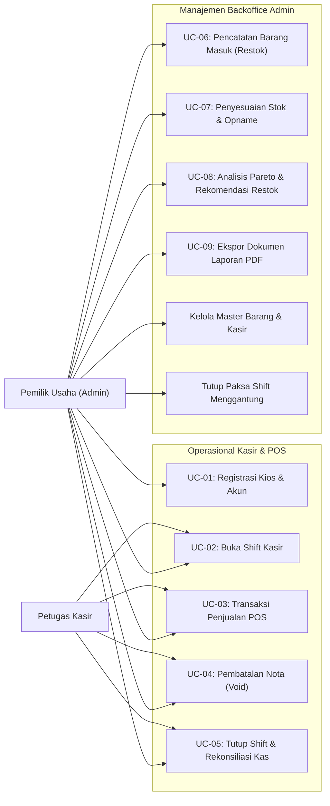

# 05. Use Case Diagram dan Skenario Kasus Penggunaan

Dokumen ini menyajikan model fungsional sistem **Stokify** melalui Diagram Kasus Penggunaan (*Use Case Diagram*) dan tabel spesifikasi terperinci untuk 9 use case inti operasional.

---

## 1. Diagram Use Case (Mermaid)

---

## 2. Tabel Spesifikasi 9 Skenario Use Case Utama

### UC-01: Registrasi Kios dan Akun Pemilik
- **Aktor Utama**: Pemilik Kios (Pengguna Baru)
- **Prakondisi**: Pengguna belum terdaftar dan memiliki koneksi internet.
- **Pemicu**: Pengguna menekan tombol "Daftar Kios" di halaman depan.
- **Alur Normal**:
  1. Pengguna memasukkan nama kios, nama pemilik, email unik, dan kata sandi minimal 8 karakter.
  2. Sistem memvalidasi data form dan keunikan email secara global.
  3. Sistem membuat baris `kios` baru dengan parameter ROP default.
  4. Sistem membuat baris `users` baru ber-role `admin` terhubung ke `kios_id`.
  5. Sistem otomatis mengautentikasi pengguna dan mengarahkan ke Dashboard Admin.
- **Alur Alternatif / Gagal**:
  - Email sudah pernah terdaftar: Sistem menampilkan pesan error validasi *"Email sudah terdaftar."*
  - Kata sandi kurang dari 8 karakter: Sistem menolak submit form.
- **Pasca-kondisi**: Kios dan admin aktif, isolasi multi-tenant mulai berlaku.

---

### UC-02: Buka Shift Kasir
- **Aktor Utama**: Petugas Kasir atau Admin
- **Prakondisi**: Pengguna telah login dan saat ini **tidak memiliki shift yang sedang berjalan**.
- **Pemicu**: Pengguna mengakses halaman `/kasir` atau menekan tombol "Buka Shift".
- **Alur Normal**:
  1. Sistem menampilkan formulir pembukaan shift dengan identitas kasir yang login.
  2. Kasir menghitung uang kas kecil awal di laci kasir dan menginput nominal modal awal (misal: Rp 100.000).
  3. Kasir menekan tombol "Buka Shift Sekarang".
  4. Sistem mencatat baris baru pada tabel `shift_kasir` berstatus `berjalan` dengan `waktu_buka` saat ini.
  5. Sistem mencatat log aktivitas `shift.buka` dan mengarahkan kasir langsung ke layar kasir POS.
- **Alur Alternatif / Gagal**:
  - Pengguna sudah memiliki shift aktif: Sistem menolak pembukaan shift kedua dan mengarahkan ke shift yang ada.
  - Modal awal diisi angka negatif: Sistem menampilkan error validasi *"Modal awal minimal Rp 0."*
- **Pasca-kondisi**: Kasir memiliki shift berstatus `berjalan` dan diizinkan melayani transaksi POS.

---

### UC-03: Transaksi Penjualan POS Kasir
- **Aktor Utama**: Petugas Kasir atau Admin
- **Prakondisi**: Kasir memiliki shift yang sedang berjalan.
- **Pemicu**: Pembeli membawa belanjaan barang ke meja kasir.
- **Alur Normal**:
  1. Kasir mencari barang melalui ketik nama atau scan barcode (endpoint pencarian tidak memuat harga modal).
  2. Kasir menambahkan barang ke keranjang belanja dan menentukan kuantitas beli.
  3. Sistem menghitung subtotal dan total belanja secara real-time di browser.
  4. Kasir menginput nominal uang tunai yang diserahkan pembeli.
  5. Kasir menekan tombol "Selesaikan Pembayaran & Cetak Struk".
  6. Sistem menjalankan database transaction:
     - Mengunci baris barang terkait (`lockForUpdate`).
     - Memverifikasi kecukupan saldo persediaan fisik.
     - Mengambil snapshot harga jual dan harga modal saat ini dari database.
     - Menyimpan header `penjualan` dan rincian `detail_penjualan`.
     - Mengurangi saldo `stok` pada tabel `barang`.
     - Menyimpan baris kartu stok pada `mutasi_stok` (tipe `penjualan`).
  7. Sistem mengembalikan data nota dan memunculkan pop-up struk thermal siap cetak.
- **Alur Alternatif / Gagal**:
  - Saldo stok tidak mencukupi: Sistem membatalkan seluruh transaksi (*rollback*) dan memunculkan pesan spesifik *"Stok [Nama Barang] tidak mencukupi (sisa X, diminta Y)."*
  - Uang tunai kurang dari total: Tombol submit terkunci atau form menolak proses pembayaran.
  - Gangguan jaringan / submit ganda: Idempotency `token` unik mencegah pemotongan stok berulang.
- **Pasca-kondisi**: Nota tersimpan, saldo stok fisik berkurang, mutasi tercatat.

---

### UC-04: Pembatalan Transaksi Penjualan (Void)
- **Aktor Utama**: Petugas Kasir (nota sendiri) atau Admin (seluruh nota kios)
- **Prakondisi**: Nota penjualan berstatus `selesai` dan shift kasir yang menaungi nota tersebut **masih berstatus berjalan**.
- **Pemicu**: Pembeli membatalkan pembelian atau kasir salah menginput nota belanja.
- **Alur Normal**:
  1. Pengguna membuka riwayat transaksi atau detail nota.
  2. Pengguna menekan tombol "Batalkan Nota (Void)".
  3. Sistem memunculkan modal konfirmasi pembatalan.
  4. Pengguna memasukkan alasan pembatalan minimal 5 karakter (misal: "Salah input barang pembeli").
  5. Pengguna menekan tombol "Konfirmasi Void".
  6. Sistem menjalankan database transaction:
     - Mengubah status nota `penjualan` menjadi `dibatalkan`, mencatat `dibatalkan_oleh`, `dibatalkan_pada`, dan `alasan_batal`.
     - Mengembalikan kuantitas barang ke saldo `stok` pada tabel `barang`.
     - Mencatat baris mutasi pengembalian pada `mutasi_stok` (tipe `void_penjualan`).
     - Mencatat jejak audit `penjualan.void` pada `log_aktivitas`.
  7. Sistem me-refresh tampilan riwayat dengan badge merah "Dibatalkan".
- **Alur Alternatif / Gagal**:
  - Shift kasir nota tersebut sudah ditutup: Sistem menolak void dengan error *"Nota tidak dapat dibatalkan karena shift kasir telah ditutup."*
  - Kasir mencoba membatalkan nota milik kasir lain: Sistem menolak dengan HTTP 403 Forbidden.
  - Alasan kosong atau < 5 karakter: Sistem menampilkan pesan validasi *"Alasan pembatalan minimal 5 karakter."*
- **Pasca-kondisi**: Status nota berubah `dibatalkan`, stok kembali bertambah, nota dikeluarkan dari omzet shift.

---

### UC-05: Tutup Shift Kasir dan Rekonsiliasi Kas Laci
- **Aktor Utama**: Petugas Kasir
- **Prakondisi**: Kasir memiliki shift yang berstatus `berjalan`.
- **Pemicu**: Jam kerja kasir berakhir.
- **Alur Normal**:
  1. Kasir membuka menu "Tutup Shift".
  2. Kasir melakukan **hitung buta (*blind count*)** terhadap seluruh uang kertas dan receh di laci kasir (sistem sengaja menyembunyikan angka penjualan sistem).
  3. Kasir menginput nominal uang fisik yang dihitungnya.
  4. Jika uang fisik pas dengan hitungan sistem, kasir dapat langsung menekan "Tutup Shift".
  5. Sistem menghitung:
     - `uang_seharusnya = modal_awal + total_penjualan_tunai_selesai`
     - `selisih = uang_fisik - uang_seharusnya`
  6. Sistem memperbarui baris `shift_kasir`: `status` menjadi `ditutup`, mengunci nilai uang, dan mencatat `waktu_tutup`.
  7. Sistem mengarahkan kasir ke halaman Rekap Hasil Shift.
- **Alur Alternatif / Gagal**:
  - Terjadi selisih uang (uang fisik tidak sama dengan uang seharusnya): Sistem mewajibkan kasir mengisi formulir catatan penjelasan selisih sebelum tombol tutup dapat dieksekusi.
  - Kasir belum mengisi uang fisik: Sistem menolak submit tutup shift.
- **Pasca-kondisi**: Shift ditutup permanen, seluruh nota terkunci dari void, kasir harus membuka shift baru untuk bertransaksi kembali.

---

### UC-06: Pencatatan Pengadaan Barang Masuk (Restok)
- **Aktor Utama**: Pemilik Usaha (Admin)
- **Prakondisi**: Admin terautentikasi (role: admin).
- **Pemicu**: Pasokan barang tiba dari distributor / supplier bersama faktur pengiriman.
- **Alur Normal**:
  1. Admin membuka menu "Barang Masuk" -> "Catat Barang Masuk".
  2. Admin memilih nama supplier mitra, tanggal kedatangan, dan menambahkan baris-baris barang yang diterima.
  3. Untuk setiap barang, Admin menginput jumlah pasokan dan harga beli per unit saat ini.
  4. Admin menekan tombol "Simpan Penerimaan Barang".
  5. Sistem menjalankan kalkulasi Harga Pokok Penjualan (HPP) berbasis **Moving Average**:
     $$\text{HPP Baru} = \frac{(\text{Stok Lama} \times \text{HPP Lama}) + (\text{Jumlah Masuk} \times \text{Harga Beli})}{\text{Stok Lama} + \text{Jumlah Masuk}}$$
  6. Sistem menambah saldo `stok` barang, memperbarui `harga_modal` barang dengan HPP baru, mencatat header `barang_masuk`, rincian `detail_barang_masuk`, dan buku besar `mutasi_stok` (tipe `barang_masuk`).
- **Alur Alternatif / Gagal**:
  - Kasir mencoba mengakses: Sistem langsung mengembalikan status HTTP 403 Forbidden.
  - Jumlah atau harga beli $\le 0$: Sistem menampilkan error validasi.
- **Pasca-kondisi**: Stok bertambah, HPP master barang terbarukan secara otomatis.

---

### UC-07: Penyesuaian Stok dan Eksekusi Stok Opname
- **Aktor Utama**: Pemilik Usaha (Admin)
- **Prakondisi**: Admin terautentikasi.
- **Pemicu**: Ditemukan barang rusak/bocor, atau Admin selesai melakukan audit fisik stok di rak toko.
- **Alur Normal**:
  1. Admin membuka menu "Penyesuaian Stok" -> memilih tab "Penyesuaian Manual" atau "Stok Opname".
  2. Pada mode Opname: Admin menginput hasil hitung fisik barang di rak.
  3. Sistem mendeteksi otomatis barang-barang yang memiliki selisih antara stok sistem vs stok fisik.
  4. Admin memasukkan alasan selisih untuk setiap barang (misal: "Kemasan bocor digigit tikus").
  5. Admin menekan "Eksekusi Penyesuaian Stok".
  6. Sistem memperbarui saldo `stok` menjadi persis sama dengan stok fisik, menghitung nilai total kerugian stok berdasarkan snapshot HPP saat ini, dan mencatat pergerakan ke `mutasi_stok`.
- **Alur Alternatif / Gagal**:
  - Tidak ada perbedaan antara stok fisik dan sistem pada opname: Sistem menolak eksekusi karena tidak ada saldo yang perlu disesuaikan.
- **Pasca-kondisi**: Stok sistem kembali sinkron 100% dengan kondisi fisik riil di rak.

---

### UC-08: Analisis Performa Barang (Pareto) dan Rekomendasi Restok
- **Aktor Utama**: Pemilik Usaha (Admin)
- **Prakondisi**: Admin terautentikasi dan kios memiliki riwayat transaksi selesai.
- **Pemicu**: Admin hendak merencanakan pengadaan barang mingguan.
- **Alur Normal**:
  1. Admin membuka menu "Analisis & Laporan" -> "Performa Barang".
  2. Admin memilih periode analisis (7, 14, 30, 60, atau 90 hari terakhir).
  3. Sistem mengkalkulasi kontribusi penjualan setiap barang berdasarkan aturan Pareto ABC:
     - Kategori A (Fast Moving): Kontributor s/d 80% omzet.
     - Kategori B (Medium Moving): Kontributor 80% - 95% omzet.
     - Kategori C (Slow Moving): Kontributor di atas 95% omzet.
  4. Sistem menghitung Titik Pesan Ulang (*Reorder Point* / ROP) berdasarkan formula:
     $$\text{ROP} = (\text{Penjualan Harian Rata-rata} \times \text{Lead Time}) + \text{Safety Stock}$$
  5. Sistem menampilkan daftar barang yang perlu segera dibeli beserta rekomendasi kuantitas belanja.
  6. Admin dapat mengunduh daftar belanja tersebut ke berkas PDF resmi untuk dibawa ke agen grosir.
- **Pasca-kondisi**: Admin memiliki pedoman belanja pasokan yang objektif dan berbasis data transaksi nyata.

---

### UC-09: Penarikan dan Pengunduhan Laporan PDF
- **Aktor Utama**: Pemilik Usaha (Admin)
- **Prakondisi**: Admin terautentikasi.
- **Pemicu**: Admin membutuhkan laporan keuangan bulanan atau audit kasir.
- **Alur Normal**:
  1. Admin membuka menu "Laporan" dan memilih jenis dokumen:
     - Ringkasan Keuangan (Omzet, HPP, Laba Kotor).
     - Audit Transaksi dan Shift Kasir.
     - Status Persediaan Stok Barang.
  2. Admin menentukan filter tanggal (harian, mingguan, bulanan, atau rentang kustom).
  3. Sistem memproses data berdasarkan snapshot transaksi berstatus selesai.
  4. Admin menekan tombol "Unduh PDF".
  5. Sistem merender halaman PDF via engine DomPDF (dilengkapi identitas profil kios, catatan kaki akuntansi, dan nomor urut).
  6. Sistem mencatat jejak audit `laporan.cetak` pada `log_aktivitas` dan browser mengunduh berkas PDF.
- **Alur Alternatif / Gagal**:
  - Permintaan unduh PDF dilakukan bertubi-tubi (> 20 kali dalam 1 menit): Rate limiter membatasi dengan respon HTTP 429 Too Many Requests.
  - Kasir mencoba mengakses URL laporan: Server melempar respon HTTP 403 Forbidden.
- **Pasca-kondisi**: Berkas PDF resmi berhasil diunduh dan tersimpan di perangkat Admin.
