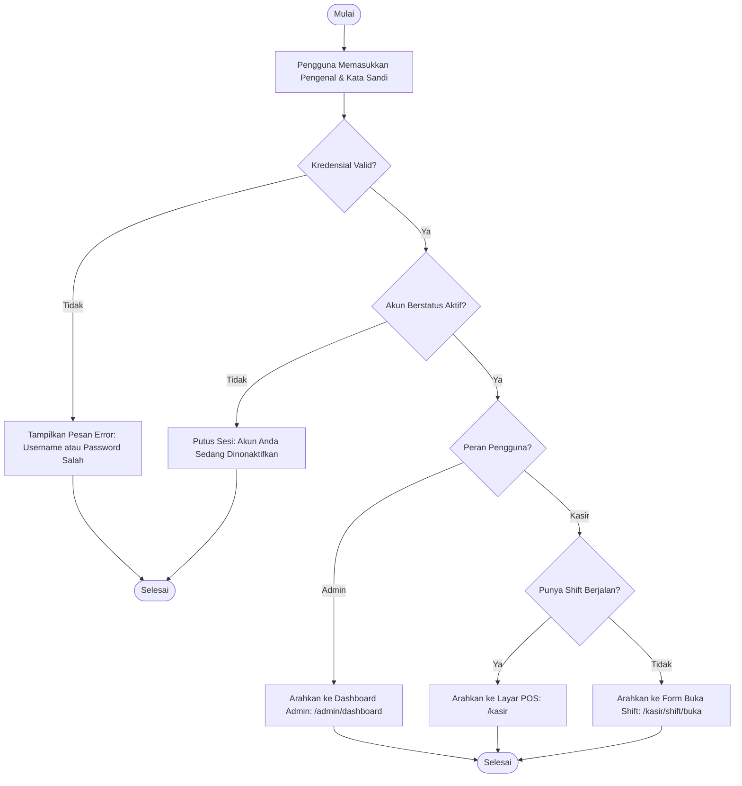
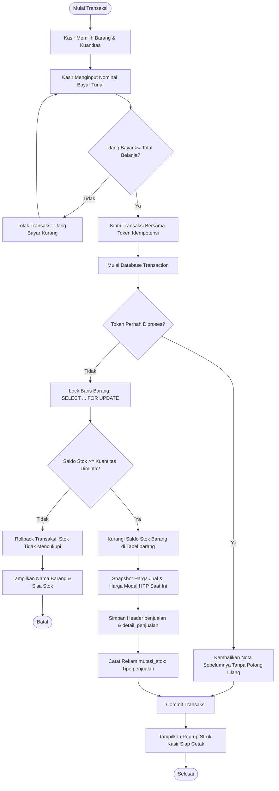
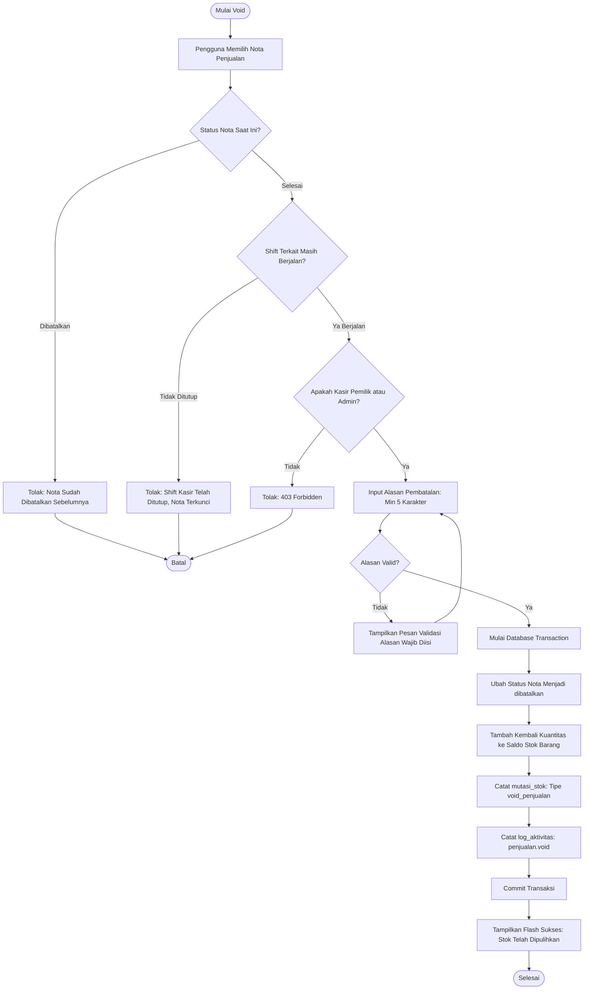
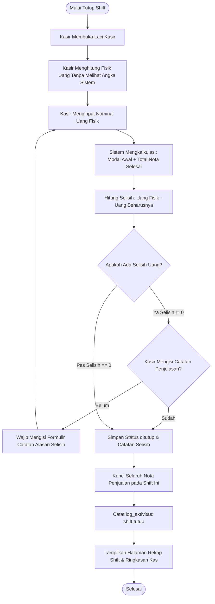
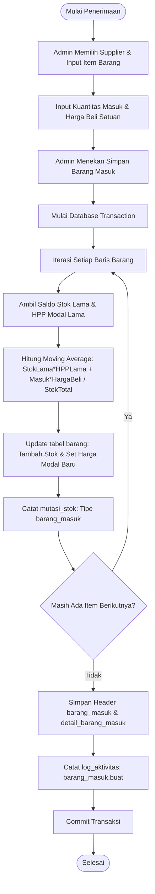
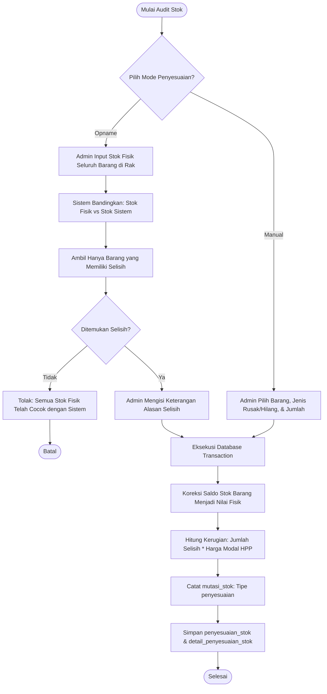
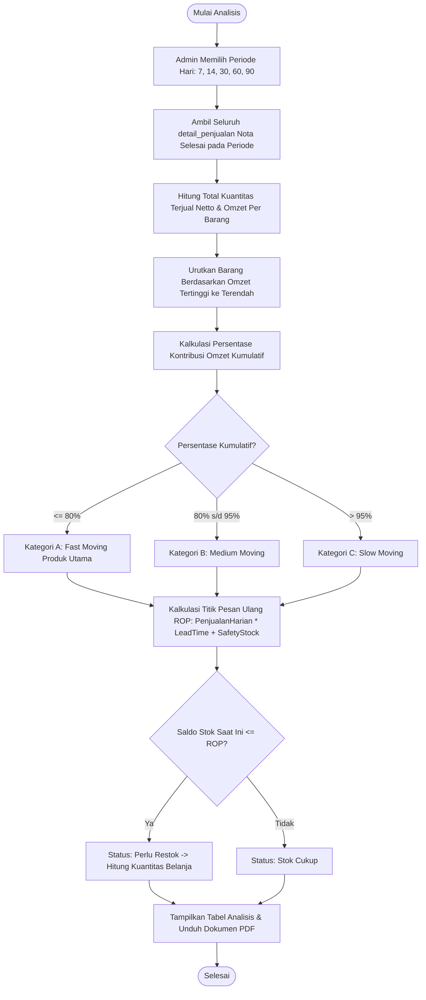

# 06. Flowchart Alur Proses Bisnis

Dokumen ini memvisualisasikan 7 diagram alur proses (*Flowchart*) utama sistem **Stokify** menggunakan notasi standar Mermaid (`flowchart TD`).

---

## 1. Flowchart Login dan Redirection Pengguna

Menggambarkan alur autentikasi fleksibel (email, username, atau nama kios) beserta pengalihan halaman berdasarkan hak peran (*role*).

---

## 2. Flowchart Transaksi Penjualan Kasir POS

Menggambarkan proses transaksi kasir dengan penguncian baris (`lockForUpdate`), verifikasi stok, pemotongan stok otomatis, dan pencetakan struk.

---

## 3. Flowchart Pembatalan Transaksi Penjualan (Void)

Menggambarkan aturan bisnis pembatalan nota penjualan yang hanya diizinkan selama shift kasir masih aktif berjalan.

---

## 4. Flowchart Rekonsiliasi Kas dan Tutup Shift

Menggambarkan proses tutup shift dengan audit hitung buta uang fisik laci kasir.

---

## 5. Flowchart Penerimaan Barang Masuk & Moving Average HPP

Menggambarkan penerimaan pasokan supplier dan rekalkulasi otomatis HPP persediaan.

---

## 6. Flowchart Penyesuaian Stok & Stok Opname

Menggambarkan alur audit fisik stok dan penyesuaian kerugian persediaan.

---

## 7. Flowchart Rekomendasi Restok (Pareto & ROP)

Menggambarkan mesin analitik persediaan barang dan saran pengadaan.

